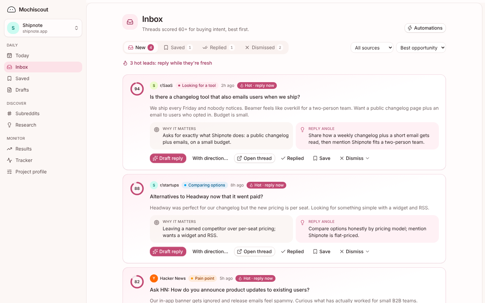
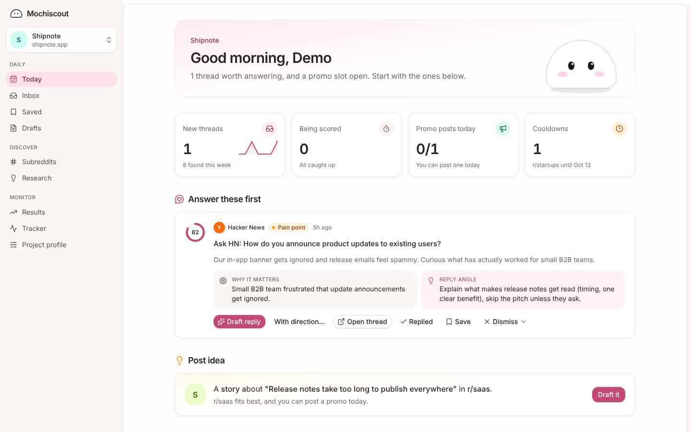

<div align="center">


# Mochiscout

**Find people asking for your product on Reddit, Hacker News, Bluesky and X,<br>and reply helpfully, without getting banned.**

[](https://github.com/zernonia/mochiscout/actions/workflows/ci.yml)
[](LICENSE)
[](https://nuxt.com)
[](https://workers.cloudflare.com)
[](CONTRIBUTING.md)

[Website](https://mochiscout.com) · [Self-host](docs/self-host.md) · [Contributing](CONTRIBUTING.md) · [Architecture](docs/arch.md)

<br>



</div>

## Why Mochiscout

Every day someone asks "is there a tool that…?" about exactly what you built. Mochiscout finds those threads while they're fresh, tells you why each one matters, checks the community's rules, and drafts a reply in your voice. **You** read it, edit it and post it yourself.

- 🎯 **Buying intent, not keyword noise.** Every thread is scored 0–100 for how close the poster is to wanting your product, with the reason and a suggested angle.
- 🧭 **Rules before you post.** A library of subreddit rules (self-promo policy, links, karma, cooldowns) plus each sub's official rules, checked on every draft.
- ✍️ **Drafts that sound like you.** Replies use the real details you give it and learn from the replies you actually posted. No invented facts.
- 📈 **Proof it works.** Tracking links count the visits and sign-ups each reply brings, and posted replies are checked so you hear when one gets removed.

## How it works

**Research → Map → Watch → Draft → Track**

1. **Research** the pain points your buyers talk about.
2. **Map** the subreddits they gather in, with each one's promotion rules.
3. **Watch** Reddit, Hacker News, Bluesky and X for buying-intent threads, scored every 15 minutes.
4. **Draft** rule-checked replies and posts. You always post yourself.
5. **Track** what you posted: visits, sign-ups, removals and shadowbans.

<div align="center">

</div>

## Features

| | |
| --- | --- |
| **Inbox** | Threads scored for buying intent, best opportunities first: fresh, uncrowded and still open. Save, mark replied or dismiss with a reason; scoring learns from it. |
| **Reply drafts** | Drafts from the full thread and its replies, in your voice, with the subreddit's rules applied. Steer a redraft ("shorter, mention I built it for my own team"). |
| **Subreddit map** | Where your buyers are, how well each sub fits, and what it allows. Search any subreddit by name. |
| **Research** | Pain points clustered from real threads, ready for posts, landing copy and your roadmap. |
| **Drafts** | Rule-checked Reddit posts with a tone check before you post. |
| **Results & Tracker** | Visits and sign-ups per reply from tracking links; live/removed checks for what you posted; shadowban checks for your account. |
| **Alerts & digest** | Hot-lead alerts by email, Slack or Discord, and a daily digest. |
| **AI agents (MCP)** | An MCP server for Claude Code and other agents, plus a [skill](skills/mochiscout/SKILL.md) for the daily routine. |
| **Browser extension** | Optional: read Reddit through your own browser session when a server can't ([apps/extension](apps/extension)). |

## Principles

- **You post, always.** No auto-posting, no auto-commenting, no DMs, no vote manipulation.
- **No Reddit API.** Public RSS and search only; it works within Reddit's public limits.
- **Honest replies.** Drafts disclose when you built the product and never make up facts.
- **Yours to run.** Self-host it for free on your own Cloudflare account, or use the hosted service.

## Hosted or self-hosted

| | [mochiscout.com](https://mochiscout.com) | Self-hosted |
| --- | --- | --- |
| Price | Free plan, paid plans with a 14-day Pro trial | Free (you pay Cloudflare and your API keys) |
| Setup | Paste your URL | About 15 minutes, see [the guide](docs/self-host.md) |
| AI and search keys | Included | Bring your own Anthropic and TinyFish (free) keys |
| Updates | Automatic | `git pull` and redeploy |

## Quick start (local)

You need **Node 22+** and **pnpm 10**.

```sh
git clone https://github.com/zernonia/mochiscout.git
cd mochiscout
pnpm install
cp apps/web/.dev.vars.example apps/web/.dev.vars   # set NUXT_SESSION_PASSWORD (32+ characters)
pnpm db:migrate:local                               # create the local D1 database
pnpm dev                                            # http://localhost:3000
```

Sign up with email and password; the first account owns the instance. Everything else is optional:

| Key | Unlocks |
| --- | --- |
| `ANTHROPIC_API_KEY` | Onboarding from your URL, intent scoring, research, reply drafts |
| `TINYFISH_API_KEY` (free) | Thread and subreddit discovery, reading subreddits' official rules |
| GitHub / Google OAuth | Social sign-in and team invites |
| `EMAIL_FROM` or `RESEND_API_KEY` | Digests and invites (printed to the log otherwise) |

The full list is in [`apps/web/.dev.vars.example`](apps/web/.dev.vars.example). Scheduled jobs can be run by hand at `/_nitro/tasks/dispatch`.

```sh
pnpm test             # unit tests
pnpm typecheck        # all packages and the app
pnpm rules:validate   # subreddit rules library
```

## Deploy

Mochiscout is one Cloudflare Worker with a D1 database, a KV namespace and a cron trigger. Follow **[docs/self-host.md](docs/self-host.md)** to create them, set your secrets and run `pnpm run deploy`.

## Use it from an AI agent

Create an API key in **Settings → API keys**, then:

```sh
claude mcp add --transport http mochiscout https://<your-instance>/mcp --header "Authorization: Bearer sr_..."
```

Tools include `get_today`, `list_threads`, `draft_reply`, `get_tracking_link`, `get_results`, `search_subreddits`, `watch_subreddit` and more. The MCP server is on the Pro plan of the hosted edition and always on when self-hosted.

## Project structure

```
apps/
  web/          Nuxt 4 app on Cloudflare Workers (pages, API routes, cron tasks)
  extension/    Optional browser extension (WXT)
packages/
  core/         Jobs, scoring, drafting, research, plans
  db/           Drizzle schema and D1 migrations
  sources/      Reddit, Hacker News, Bluesky and X adapters, HTTP client
  llm/          Anthropic client with structured output
  rules/        Subreddit rules library (YAML, CC BY-SA 4.0)
skills/         Claude Code skill for the MCP tools
docs/           Architecture and self-hosting guides
```

**Built with** [Nuxt 4](https://nuxt.com), [Vue](https://vuejs.org), [Tailwind CSS v4](https://tailwindcss.com), [coss ui](https://coss.com/ui), [Drizzle](https://orm.drizzle.team), [Cloudflare Workers, D1 and KV](https://developers.cloudflare.com), [Claude](https://www.anthropic.com/claude) and [TinyFish](https://tinyfish.ai).

## Contributing

Contributions are welcome, and the easiest place to start is the [subreddit rules library](packages/rules). Read [CONTRIBUTING.md](CONTRIBUTING.md) for setup and conventions, and please follow the [code of conduct](CODE_OF_CONDUCT.md).

Found a security issue? Please report it privately, see [SECURITY.md](SECURITY.md).

## License

Mochiscout is licensed under the [GNU AGPL v3](LICENSE): you can use, modify and self-host it, and if you offer a modified version to others over a network, you share your changes under the same license. The subreddit rules data in `packages/rules` is [CC BY-SA 4.0](packages/rules/LICENSE). Third-party code is listed in [THIRD_PARTY_NOTICES.md](THIRD_PARTY_NOTICES.md).

The Mochiscout name, logo and mascot identify the hosted service; please give a fork its own.
