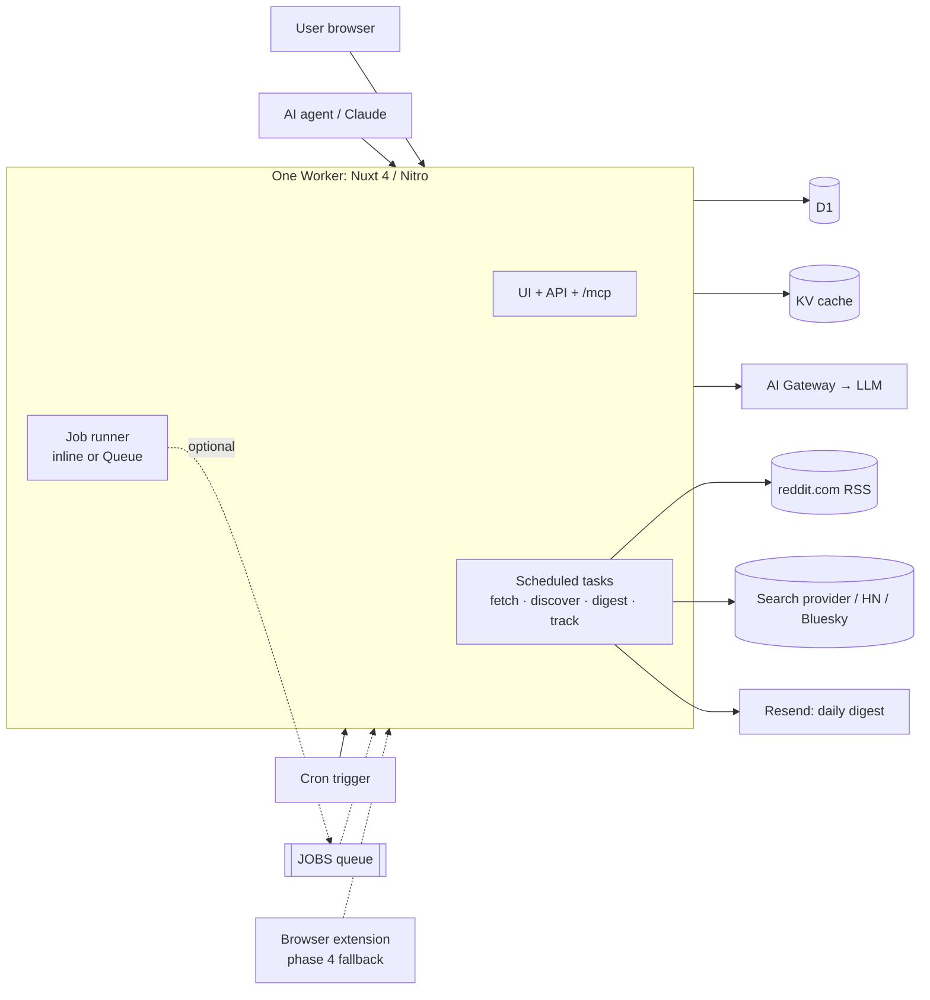

# Architecture — Open-Source Reddit Research + Marketing Loop

> Codename: `social-radar` (working name)
> Stack: Nuxt 4 · shadcn-vue · Tailwind v4 · Cloudflare (one Worker + D1, KV, Cron; Queues optional; AI Gateway)
> Editions: **Self-host** (free, AGPL) and **Cloud** (paid, hosted by us). Same codebase.

---

## 1. Product in one paragraph

Paste your product URL. The app learns your ICP, mines Reddit for the pain points your buyers talk about, maps the subreddits they gather in (with each sub's promo rules), watches those subs for buying-intent threads, drafts rule-checked posts, and tracks what you posted (removals, shadowbans). The human always posts. One loop: **Research → Map → Watch → Draft → Track**.

### Non-goals (hard rules)
- No Reddit OAuth / Data API. Ever. (This is what killed GummySearch.)
- No auto-posting, auto-commenting, DMs, or votes.
- No managed/throwaway accounts.
- No scraping at scale from our servers: read public RSS at low, cached, per-subreddit volume; use search APIs for discovery.

---

## 2. High-level architecture



**One deployable.** Everything runs in the Nuxt app's Worker:
- HTTP: UI, API, MCP.
- Cron: Nitro scheduled tasks (`nitro.scheduledTasks`) wired to Cloudflare Cron Triggers.
- Background jobs: a small job runner in `packages/core/jobs`. If a `JOBS` Queue binding exists, jobs are enqueued and consumed via Nitro's `cloudflare:queue` hook; if not, they run inline inside the cron invocation.

**Self-hosters need only D1 + KV + one cron trigger.** One `wrangler deploy`, one config file. Queues are an optional switch for the cloud edition when volume grows. If the cloud ever needs isolation, the same job code can be moved into a second Worker later without changing app code.

---

## 3. Repo layout (pnpm workspace)

```
.
├─ apps/
│  ├─ web/                 # Nuxt 4 (app/ dir) + shadcn-vue
│  │  ├─ app/
│  │  │  ├─ pages/
│  │  │  ├─ components/ui/ # shadcn-vue generated
│  │  │  ├─ components/    # feature components
│  │  │  └─ composables/
│  │  ├─ server/
│  │  │  ├─ tasks/         # Nitro scheduled tasks (fetch, discover, digest, track, retention)
│  │  │  ├─ plugins/queue.ts  # cloudflare:queue hook → job runner (only if JOBS bound)
│  │  │  ├─ api/           # REST for the UI
│  │  │  ├─ routes/mcp.ts  # MCP streamable HTTP
│  │  │  ├─ middleware/    # auth, edition, quotas
│  │  │  └─ utils/         # getDb(event), getEnv(event)
│  │  ├─ nuxt.config.ts
│  │  └─ wrangler.jsonc
│  └─ extension/           # phase 4 (WXT)
├─ packages/
│  ├─ db/                  # Drizzle schema + migrations (D1)
│  ├─ core/                # shared logic: jobs runner, scoring, rules engine, prompts, types
│  ├─ sources/             # source adapters (reddit, hn, bluesky, x, web)
│  ├─ llm/                 # provider abstraction (AI SDK) + JSON schemas
│  └─ rules/               # community subreddit rules (YAML) + build script
├─ docs/
└─ .github/workflows/      # CI, rules validation, deploy
```

---

## 4. Frontend — Nuxt 4 + shadcn-vue

- Nuxt 4 (≥ 4.6) with the `app/` directory; Nitro preset `cloudflare_module`.
- Server builder: **Nitro** (default). Do not use the experimental `@nuxt/vite-server` yet: it has no tasks or server plugins, which the scheduled jobs and queue hook rely on.
- Import server utilities from `nuxt/server` (not `h3`/`nitropack` directly) so server code carries over unchanged to Nuxt 5 / Nitro v3.
- `shadcn-nuxt` module + Tailwind v4. Generate only the components you use.
- Data fetching: `useFetch` / `$fetch` against `server/api`. No separate API client.
- Bindings in server code via `event.context.cloudflare.env` (D1, KV, optional JOBS queue). Wrap in `server/utils/env.ts`.
- Local dev against real bindings with `wrangler` (Nitro's Cloudflare dev integration / `nitro-cloudflare-dev`, whichever your Nitro version supports).

### Pages

| Route | Purpose |
|---|---|
| `/` | Landing (cloud edition only) |
| `/login` | Better Auth (GitHub, Google, magic link) |
| `/app/new` | Onboarding: paste URL → extracted ICP, keywords, competitors (editable) |
| `/app/[project]/today` | Daily plan: top threads to answer, 1 post suggestion, pacing status |
| `/app/[project]/research` | Pain-point clusters with evidence threads |
| `/app/[project]/subreddits` | Subreddit map: fit score, size, promo policy, karma/age minimums |
| `/app/[project]/inbox` | Intent-scored threads; actions: replied / dismissed / save |
| `/app/[project]/drafts` | Post drafter with live rule check |
| `/app/[project]/tracker` | Posted items: live / removed, account shadowban check |
| `/app/settings` | Keys (self-host), digest time, timezone, Reddit username |
| `/app/billing` | Polar checkout / portal (cloud only) |

UI principles: mobile-first, "10 minutes a day". `today` is the home screen.

---

## 5. Data sources (no Reddit API)

| Source | Used for | Notes |
|---|---|---|
| **Search provider**: **TinyFish** (both editions), **Brave** as fallback | Discovery: threads by keyword/intent, pain-point mining, subreddit discovery, "evergreen" threads that rank in search | TinyFish: free, 30 req/min and 500 req/hour per key, written confirmation for cloud use requested from TinyFish. Brave: ~$5 / 1k |
| **Reddit public RSS** | Freshness: `/r/{sub}/new/.rss`, thread comments `/comments/{id}/.rss` | Fetched **per subreddit, not per user**. Cached. Low volume. |
| **Public profile check** | Shadowban/suspension check for the user's own username | On demand, cached |
| **Browser extension** (phase 4) | Fallback reader using the user's own session if server reads get blocked | Sends parsed threads to `/api/ingest` |
| **Product URL fetch** | Onboarding: read landing page → ICP/keywords | One-off per project |

### Politeness + resilience
- **Serialized fetching, no Durable Object**: all reddit.com requests run sequentially inside one fetch task with a fixed delay (e.g. ≤ 1 req/s). With the optional queue, set the consumer to `max_concurrency: 1` for the same effect. One code path: `packages/sources/http.ts` (delay, backoff, conditional requests).
- Honest `User-Agent` with contact URL. Respect `429` / `Retry-After` with exponential backoff.
- Store `ETag` / `Last-Modified` per feed in KV; send conditional requests.
- Adaptive refresh: busy subs every 15 min, quiet subs every 1–6 h.
- Feature flag `READ_MODE = server | extension | search_only` so the cloud can degrade gracefully if reddit.com starts blocking.

### 5.1 Multi-source (v1.5+) — "your feed of people who need your product"

Reddit stays the deep, first-class source (rules engine, drafter, tracker). Other platforms join as **feed sources**: discovered, intent-scored, shown in the same timeline. The user always replies manually.

| Source | Access | Cost | Phase |
|---|---|---|---|
| Reddit | RSS + search `site:reddit.com` | low | v1 |
| Hacker News | Algolia HN Search API (official, public) | free | v1.5 |
| Bluesky | AT Protocol public search (`app.bsky.feed.searchPosts`; service account if auth required) | free | v1.5 |
| X | Official API (paid; check current pricing) or search `site:x.com` for partial coverage | high | v2, Pro plan only |
| LinkedIn, Threads, YouTube, Product Hunt | search `site:` queries only, best effort | low | later, labelled "beta" |

**Source adapter interface** (`packages/sources`):
```ts
interface SourceAdapter {
  id: 'reddit' | 'hn' | 'bluesky' | 'x' | 'web'
  search(query: string, since: Date): Promise<RawPost[]>   // discovery
  poll?(channel: string, cursor?: string): Promise<{ posts: RawPost[]; cursor?: string }> // e.g. subreddit RSS
  normalize(raw: RawPost): Post                              // → common shape
}
```
- Onboarding auto-generates ~30 search terms per project (no manual keyword setup); each adapter runs them on its own schedule and budget.
- Each adapter declares its own politeness settings (delay, max requests per run) used by the shared HTTP helper.
- Per-plan source access is enforced in quota middleware (e.g. X only on Pro).
- Diversifying sources reduces the single-platform risk of depending only on Reddit.

---

## 6. Ingestion + scoring pipeline (scheduled tasks in `apps/web`)

### Cron triggers
| Schedule | Job |
|---|---|
| `*/15 * * * *` | `plan-fetch`: select watched subs that are due → run fetch jobs (inline or via `JOBS`) |
| `0 */6 * * *` | `search-discovery`: per active project, run search-provider queries → upsert threads (`source=search`) |
| `0 * * * *` | `digest`: send daily digests to users whose local digest hour is now |
| `30 */12 * * *` | `tracker`: re-check tracked posts + usernames |
| `0 3 * * *` | `retention`: prune unscored threads > 90 days |

### Flow
1. **fetch job** → pull RSS sequentially through the shared HTTP helper → parse → upsert `threads` (dedupe by Reddit fullname `t3_xxx`).
2. **Prefilter (cheap, no LLM)**: for each new thread, match against each watching project's keywords/competitors/intent phrases. Only matches become score jobs. This keeps LLM cost proportional to *relevant* threads.
3. **score job** → batched (e.g. 20 threads per LLM call) → LLM (small model) with JSON schema:
   ```json
   { "intent": 0-100, "kind": "seeking_tool|comparison|complaint|pain|other",
     "reason": "one sentence", "reply_angle": "one sentence" }
   ```
   Store in `thread_scores`. Threshold per project (default 60) decides inbox visibility.
4. **Digest** → top N threads + today's suggested post → email (Resend). Same content renders `/today`.

### Search discovery queries (templates in `packages/core`)
- `site:reddit.com "{competitor}" alternative`
- `site:reddit.com best {category} tool`
- `site:reddit.com {category} "frustrated" OR "hate" OR "wish there was"`
- Freshness filter for "new"; no filter for "evergreen" (threads already ranking = long-lived traffic).

Results are cached in KV by normalized query for 6 h and **shared across projects** with identical queries.

### Search provider interface (`packages/sources/search`)
```ts
interface SearchProvider {
  id: 'tinyfish' | 'brave'
  search(q: { query: string; recencyMinutes?: number; purpose?: string; limit?: number }):
    Promise<{ title: string; url: string; snippet: string; position: number }[]>
}
```
- **TinyFish** (default, both editions): `GET https://api.search.tinyfish.ai` with `X-API-Key`. Use `include_domains=reddit.com` (preferred over the deprecated `site:`), `recency_minutes` for freshness, and `purpose` to state intent. Free; limits 30 req/min, 500 req/hour per key. Self-hosters bring their own key.
- **Cloud capacity**: 500 req/hour ≈ 12k/day ≈ ~1,200 active users at ~10 searches/user/day. The dispatcher spreads searches evenly across the hour; past that, move to a TinyFish Enterprise contract.
- **Terms**: TinyFish's ToS is ambiguous about multi-tenant SaaS use (internal-business-purposes wording). Written confirmation requested from TinyFish; if the answer is no, flip `SEARCH_PROVIDER=brave`.
- **Brave** (fallback): used automatically on TinyFish errors or 429s, or by config.
- **Hacker News**: always via the Algolia HN API, not web search. (Validation: TinyFish domain-restricted HN searches returned mostly off-topic Ask HN posts.)
- **Validated (Oct 2026)**: `site:reddit.com` and `include_domains` both return Reddit-only results; a 7-day `recency_minutes` window returned fresh threads. Relevance was mixed (roughly a third showed real buying intent, many were "I built X" posts), so the LLM intent-scoring step is required. Brave side-by-side comparison still to do.

---

## 7. Modules

### 7.1 Onboarding
URL → fetch page → LLM extracts `{ product, category, icp, problems_solved[], keywords[], competitors[] }` → user edits → project saved → kicks off research + subreddit map.

### 7.2 Research (pain points)
- Search-provider pain-point queries + RSS comments of top threads (on demand, capped).
- LLM clusters snippets into 5–15 pain points: `title, summary, severity 1-5, evidence[] (thread ids + short paraphrase), subreddits[]`.
- Re-run weekly or on demand (quota-limited in cloud).

### 7.3 Subreddit map
- Candidates = subreddits appearing in search results + RSS hits + rules DB tags matching the category.
- Fit score = weighted: frequency in relevant results, intent density, promo policy, size band.
- Enriched from `packages/rules` (karma/age minimums, promo policy, formats).

### 7.4 Rules engine (`packages/rules` + `packages/core/rules`)
Community-maintained YAML, one file per subreddit:
```yaml
name: SaaS
promo_policy: allowed_with_value   # none | weekly_thread_only | flair_only | allowed_with_value | allowed
self_promo_thread: "Weekly Feedback Thread"
min_karma: 50
min_account_age_days: 30
links_allowed: in_comments_only     # none | in_comments_only | yes
post_formats: [text]
cooldown_days: 7                    # suggested gap between promo posts
tags: [saas, startups, b2b]
notes: "Mods remove listicles. Story posts with lessons perform best."
last_verified: 2026-10-01
source: https://www.reddit.com/r/SaaS/about/rules
```
- Build script validates (zod) → `rules.json` → seeded into D1 / KV.
- CI rejects PRs with invalid schema or missing `last_verified`.
- Drafter runs **deterministic checks** (links, format, cooldown, karma/age vs user's stated account) + **LLM check** (tone too promotional? matches sub notes?).

### 7.5 Drafter
- Input: project, subreddit, angle (story / lesson / question / showcase).
- Output: title + body + rule-check report (pass / warn / fail with reasons).
- Comments are **never** drafted in full: the app gives the thread + a reply angle; the user writes the reply. (Same stance as MediaFast; also our safety story.)

### 7.6 Pacing + safety guardrails
- Per user per subreddit cooldown from rules (`cooldown_days`).
- Max promo posts per day across all subs (default 1).
- Warn when the ratio of promo to non-promo activity is high (user self-reports or extension data).
- Hard-block drafting promo for `promo_policy: none` subs.

### 7.7 Tracker
- User pastes posted URL → periodic check: live / removed by mod / removed by spam filter (from public data available).
- Username check: public profile reachable vs not → shadowban/suspension warning.

### 7.8 MCP server
`server/routes/mcp.ts`, streamable HTTP, auth via API key (Bearer) per user.
Tools: `find_subreddits`, `get_today`, `list_threads`, `draft_post`, `check_rules`, `get_pain_points`.
Also ship a Claude Code skill in `/skills` that teaches the workflow.

---

## 8. Data model (D1 via Drizzle)

```
users            id, email, name, timezone, digest_hour, reddit_username, created_at
sessions/accounts (Better Auth tables)
orgs             id, owner_id, plan, polar_customer_id      # cloud; self-host = single org
projects         id, org_id, url, name, category, icp, keywords_json, competitors_json,
                 intent_threshold, created_at
subreddits       name (pk), subscribers, rules_json, rules_version, last_rss_at,
                 rss_etag, refresh_interval_min
project_subreddits project_id, subreddit, fit_score, watching (bool)
threads          id (source-prefixed: reddit:t3_*, hn:123, bsky:at://…), platform
                 (reddit|hn|bluesky|x|web), channel (subreddit / null), title, url,
                 author, created_utc, snippet, engagement_json,
                 source (rss|search|api|extension), search_rank_flag, ingested_at
thread_scores    project_id, thread_id, intent, kind, reason, reply_angle,
                 status (new|replied|dismissed|saved), scored_at
pain_points      id, project_id, title, summary, severity, evidence_json, subreddits_json,
                 run_id, created_at
drafts           id, project_id, subreddit, title, body, angle, check_json, created_at
tracked_posts    id, project_id, url, subreddit, posted_at, status, last_checked_at
usage            org_id, period (YYYY-MM), searches, llm_input_tokens, llm_output_tokens,
                 research_runs
api_keys         id, org_id, hash, label, created_at, last_used_at
```

Indexes: `threads(subreddit, created_utc)`, `thread_scores(project_id, status, intent)`, `project_subreddits(subreddit) where watching`.

D1 size: threads are the only big table. Keep snippets short (≤ 500 chars), prune unscored rows after 90 days.

---

## 9. LLM layer (`packages/llm`)

- AI SDK (`ai`) provider abstraction → OpenAI / Anthropic / Workers AI.
- All calls go through **Cloudflare AI Gateway** (cloud): caching, logs, cost tracking, rate limits.
- Two tiers: `fast` (scoring, extraction, clustering) and `quality` (drafts, rule check).
- Every call uses a JSON schema (zod) + one retry on parse failure.
- Self-host: user supplies key(s) in env; pick model per tier in settings.

---

## 10. Editions

Controlled by `runtimeConfig.public.edition = 'cloud' | 'selfhost'`.

| | Self-host | Cloud |
|---|---|---|
| Deploy | Their own Cloudflare account (free tier fits light use) via `pnpm deploy` / Deploy-to-Cloudflare button | Ours |
| Users | Single user / single org | Multi-tenant |
| Keys | Their TinyFish key (free) or Brave key + LLM keys | Ours (included) |
| Billing, landing page | Disabled | Polar |
| Rules DB | Bundled; `pnpm rules:sync` pulls latest | Always latest |
| Quotas | None | Per plan (`usage` table + middleware) |

Self-host on Cloudflare (not Docker) is the pitch: no server to run, free tier, five minutes to deploy.

### Plans (cloud)
- **Free (waitlist/trial):** 1 project, 3 watched subs, weekly digest.
- **Solo — $19/mo:** 1 project, 15 subs, daily digest, research monthly.
- **Pro — $49/mo:** 5 projects, 50 subs, team seats, research weekly, MCP.

Quota middleware returns `402` with an upgrade payload; UI shows an upsell sheet.

---

## 11. Auth, billing, email

- **Auth:** Better Auth + Drizzle D1 adapter. GitHub, Google, magic link.
- **Billing:** Polar checkout + customer portal; webhook `server/api/webhooks/polar.post.ts` → update `orgs.plan`. Verify signatures.
- **Email:** Resend for magic links + digests. Plain, mobile-friendly HTML.
- **Product analytics:** PostHog (or your own analytics tool) on the cloud edition only; off by default in self-host.

---

## 12. Cloudflare resources

One `apps/web/wrangler.jsonc`:

| Binding | Type | Required? |
|---|---|---|
| `DB` | D1 | yes |
| `CACHE` | KV | yes (RSS ETags, search cache, rules.json) |
| Cron trigger (`*/15 * * * *`) | — | yes; Nitro dispatches tasks by schedule |
| `JOBS` | Queue | optional (cloud), consumer `max_concurrency: 1` for fetch jobs |
| AI Gateway | HTTP (account-level) | optional; direct provider calls also work |

Cron note: Cloudflare limits cron triggers per Worker, so use **one** trigger and let a dispatcher task decide which jobs are due (digest by user timezone, discovery every 6 h, etc.). Keep each cron run within the Worker's time limit by processing in batches and resuming next tick.

Secrets: `SEARCH_PROVIDER` (`tinyfish` | `brave`), `TINYFISH_API_KEY`, `BRAVE_API_KEY` (optional fallback), `OPENAI_API_KEY` / `ANTHROPIC_API_KEY`, `BETTER_AUTH_SECRET`, `RESEND_API_KEY`, `POLAR_ACCESS_TOKEN`, `POLAR_WEBHOOK_SECRET`.

Environments: `dev` (local wrangler), `staging`, `production`. Migrations: `drizzle-kit generate` → `wrangler d1 migrations apply`.

---

## 13. Cost model (cloud, per paying user / month — estimates)

| Item | Assumption | Cost |
|---|---|---|
| Searches | ~300 via TinyFish (free within 500 req/hour); Brave fallback ~$1.50 | ~$0 |
| LLM scoring | prefilter keeps it to ~1–3k short calls | ~$0.50–1.50 |
| LLM drafts + research | ~30 drafts, 1–4 research runs | ~$0.50–1.50 |
| Cloudflare | Workers paid plan amortized | <$0.20 |
| **Total** | | **~$1.50–3.50** |

Biggest lever: RSS is fetched per subreddit, so cost scales with distinct watched subs, not users.
Track actuals from day one in `usage` + AI Gateway; alert if any org exceeds 2× plan average.

---

## 14. Security + compliance

- Never ask for Reddit passwords or OAuth.
- `packages/sources/http.ts` is the only path to reddit.com and other sources (delay, backoff, honest User-Agent).
- Store API keys hashed; self-host secrets only via wrangler secrets.
- Clear ToS: users are responsible for following subreddit rules; the app enforces guardrails by default.
- Licensing: app code **AGPL-3.0** (blocks closed hosted forks), rules data **CC BY-SA 4.0**.

---

## 15. Build roadmap (ship before GummySearch's Dec 1 shutdown)

### Phase 1 — Weeks 1–2: "works for me"
- [x] Monorepo, Nuxt 4 + shadcn-vue, D1 + Drizzle, Better Auth
- [x] Onboarding from URL
- [ ] Rules package with first ~50 subreddits (YAML + validator) — package, validator and CI done; rule files still to write
- [x] Scheduled tasks: cron dispatcher → fetch jobs (inline) → RSS via shared HTTP helper
- [x] Prefilter + LLM scoring → Inbox page
- [x] `SearchProvider` interface + TinyFish adapter (default) + Brave adapter (fallback) + discovery job
- [ ] Email TinyFish sales about commercial/multi-tenant use
- [x] Subreddit map page
- [ ] Use it daily on own projects

### Phase 2 — Week 3: "full loop"
- [x] Research (pain-point clusters)
- [x] Drafter + rule check + pacing guardrails
- [x] Tracker + shadowban check
- [x] Today page + daily digest email
- [ ] Self-host deploy docs; repo public; README with real results — deploy docs done (docs/self-host.md)

### Phase 3 — Weeks 4–6: "cloud"
- [x] Multi-tenant org model, quotas, Polar billing
- [x] Landing page + "GummySearch alternative" pages
- [x] MCP endpoint + Claude Code skill
- [ ] Waitlist → launch (Show HN, r/selfhosted, r/SideProject, X) — waitlist mode built (`NUXT_PUBLIC_WAITLIST`); launch is yours

### Phase 3.5 — "multi-source feed"
- [x] `packages/sources` adapter interface (Reddit keeps its own RSS + search jobs)
- [x] Hacker News adapter (Algolia) + Bluesky adapter
- [x] Unified feed view (`/app/[project]/inbox` becomes a timeline with platform filters)
- [x] Auto-generated ~30 search terms per project at onboarding

### Phase 4 — later
- [x] X adapter (Pro plan only, priced to cover API cost)
- [x] Browser extension fallback (WXT)
- [x] Weekly research reports, team seats polish
- [x] Rules DB contributor flow from inside the app ("suggest a rule change")

---

## 16. Open decisions

- Final product name + domain.
- Default LLM providers per tier (cost vs quality test on 200 real threads).
- Whether thread comments RSS is fetched server-side or only via extension.
- Free cloud tier vs trial only.
- How much of the rules DB to seed by hand before launch (target: top 100 founder/indie/SaaS/ecom subs).
